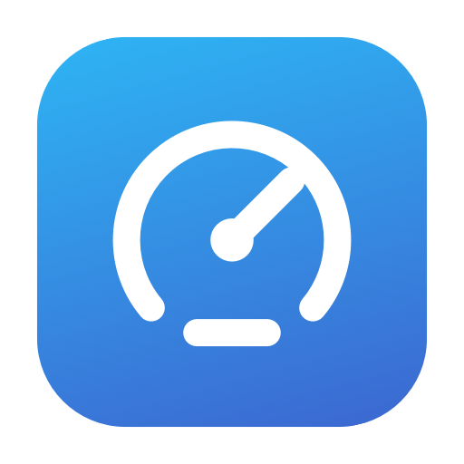
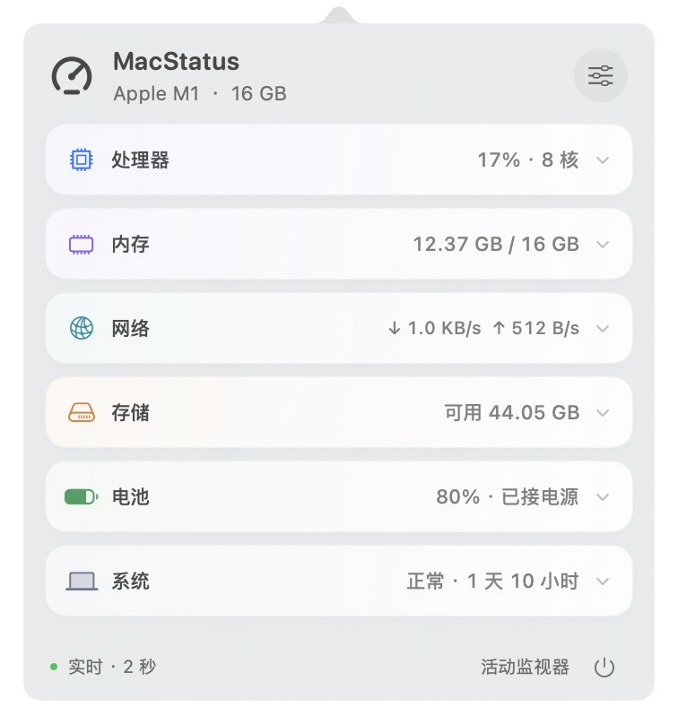
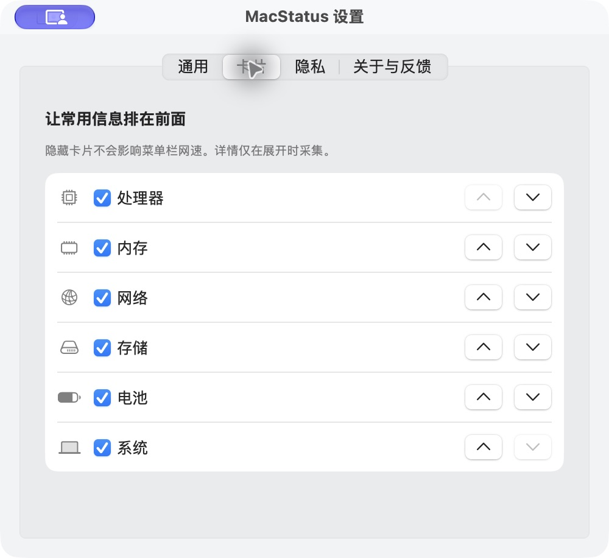

<p align="center"></p>
<h1 align="center">MacStatus</h1>
<p align="center"><strong>Your Mac, at a glance.</strong><br />A native, compact macOS menu bar monitor with on-demand sampling.</p>
<p align="center"><a href="README.md">简体中文</a> · <a href="#build-and-run">Build and run</a> · <a href="ROADMAP.md">Roadmap</a> · <a href="https://github.com/zouxianggggg/MacStatus/issues">Feedback</a></p>
<p align="center">
  <a href="https://github.com/zouxianggggg/MacStatus/actions/workflows/ci.yml"></a>
  <a href="LICENSE"></a>
  
</p>
<p align="center"></p>

## One icon. Six views into your Mac.

Check upload and download activity, find busy processes, or inspect the public IP observed by the app's network request. MacStatus lives in the menu bar, with a compact overview and expandable details.

- **Compact cards:** a roughly 352 × 378 pt default overview; one line per module. Reorder, hide, and expand cards in place.
- **Stable network speed:** optional upload, download, or two stacked speed lines. Fixed width and monospaced digits keep the icon steady.
- **Network details:** public IPv4 / IPv6, country flags, ISP / ASN, local addresses, DNS, interface MTU, and Wi-Fi link data. Copy addresses with one click.
- **On-demand detail:** per-core CPU usage, CPU / memory process rankings, disk activity, battery readings, and system information.
- **Native UI:** Swift, AppKit, and SwiftUI; system materials, light / dark appearance, a settings window, onboarding, and a system login-item toggle.
- **Resource-conscious sampling:** one sampler timer, slower background reads, and separate network-only refreshes. In-memory history and no per-frame chart animation.

> **0.5.0 is an open-source preview.** Build from source to try it. There is no Developer ID-signed, Apple-notarized installer yet. Long-running validation, broader hardware coverage, and an actual login-launch test remain outstanding. The app UI is currently in Simplified Chinese.

## What is included

| Module | Details |
| --- | --- |
| CPU | Overall / user / system usage, per-core readings, load averages, top processes, and a trend chart |
| Memory | Usage, pressure, compression, cache, swap, cumulative page I/O, and process RSS ranking |
| Network | Transfer rates and counters, public IP and country, interfaces, gateway / DNS / proxy, and Wi-Fi signal / link rate |
| Storage | Capacity, free space, filesystem, access mode, and aggregate block-driver read / write activity |
| Battery | Charge state, cycles, raw capacity ratio, voltage / current, battery-side power, and adapter rating |
| System | Model, chip, logical / physical / performance / efficiency cores, OS / kernel, uptime, and thermal state |

Unavailable readings stay unavailable. GPU metrics, temperatures, fan control, and whole-machine power are not implemented. Read [metric definitions](docs/TECHNICAL_NOTES.md) for scope and caveats.

## Build and run

Use a Mac with Xcode or compatible developer tools providing Swift 5.9+ and a macOS SDK. There are no third-party Swift package dependencies.

```sh
git clone https://github.com/zouxianggggg/MacStatus.git
cd MacStatus
./scripts/build.sh
open dist/MacStatus.app
```

The script builds for the host architecture and applies a local ad-hoc signature. You can also open `Package.swift` in Xcode.

Click the gauge in the menu bar, then click a card to expand or collapse it. The settings button controls card order, visibility, sampling, and network display. `⌘ ,` opens settings; `⌘ W` closes the settings window. Right-click the status item to quit.

The deployment target is **macOS 13+**. Manual UI verification has been performed on **Apple M1 / 16 GB / macOS 27.2**. Intel, other OS versions, and multi-display behavior still need real-device validation. CI build results are not a substitute for hardware compatibility testing.

<details>
<summary><strong>Card settings</strong></summary>
<br />

</details>

## Sampling that respects the background

| State | Standard | Eco |
| --- | --- | --- |
| Panel visible | Every 2 seconds | Every 5 seconds |
| Panel closed: full metrics | About every 10 seconds | About every 30 seconds |
| Menu bar speed enabled | Network-only refresh every 2 seconds | Network-only refresh every 5 seconds |
| Process / core / disk activity / Wi-Fi detail | Only for the expanded module | Only for the expanded module |

History is capped at 15 minutes / 450 points in memory. Charts show a fixed two-minute window and start accumulating real samples from the right. Sleep stops sampling; wake resets delta baselines. Settings and onboarding are created on demand and their window references are released on close.

In one **30-second background sample** on Apple M1 / macOS 27.2 with both speed lines enabled, 0.5.0 averaged **0.9% of one CPU core** and about **14 MB physical footprint** after a cold start. After using and closing settings, the footprint was about **39 MB**. These are observations for specific conditions, not guarantees of battery life or long-term memory behavior. See [the measurement record](docs/PERFORMANCE.md).

## Privacy

Local monitoring stays on the Mac. There are no accounts, telemetry, or automatic report uploads.

Opening network detail can contact [ipify](https://www.ipify.org/) to determine the request's public IP, then [ipwho.is](https://ipwhois.io/documentation) to look up that address's country and provider. These services see the public request IP; the app does not attach local metrics, LAN addresses, or device identifiers. Results are cached in memory for five minutes.

Disable this in **Settings → Privacy** to cancel requests and clear results. Local transfer rates continue working. Flags represent an IP database's country assignment; proxy / VPN routing may affect the observed HTTPS egress.

The built-in feedback report contains only basic environment and sampling settings. Review any screenshots or text you add before sharing. See [privacy details](docs/PRIVACY.md).

## Help shape the next release

[Report a bug or request a feature](https://github.com/zouxianggggg/MacStatus/issues/new/choose), contribute compatibility observations, or help improve metric accuracy, native interactions, and resource use.

Next priorities: network diagnostics, restrained sustained-condition alerts, and bounded historical storage. Signing, notarization, and update distribution follow in the [roadmap](ROADMAP.md). Stars and thoughtful feedback help other Mac users find the project.

```sh
swift test --cache-path "$PWD/.build/cache" --scratch-path "$PWD/.build"
./scripts/build.sh
```

There are currently 28 unit checks covering counter wrap / resets, reconnection, chart startup behavior, preferences, sampling policy, and stable menu bar geometry. See [development notes](docs/DEVELOPMENT.md) and [contribution guidelines](CONTRIBUTING.md).

[MIT License](LICENSE).
