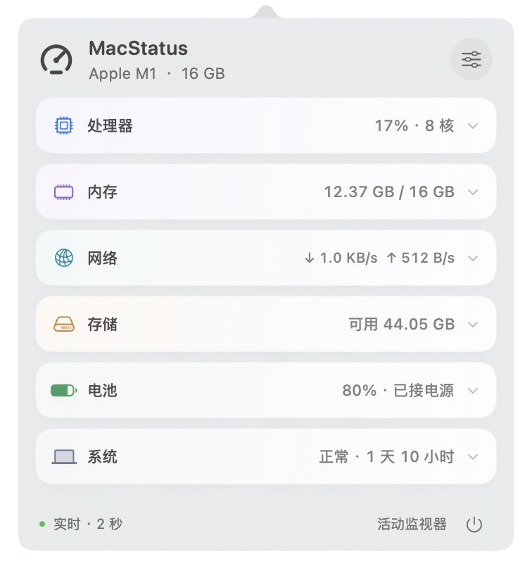
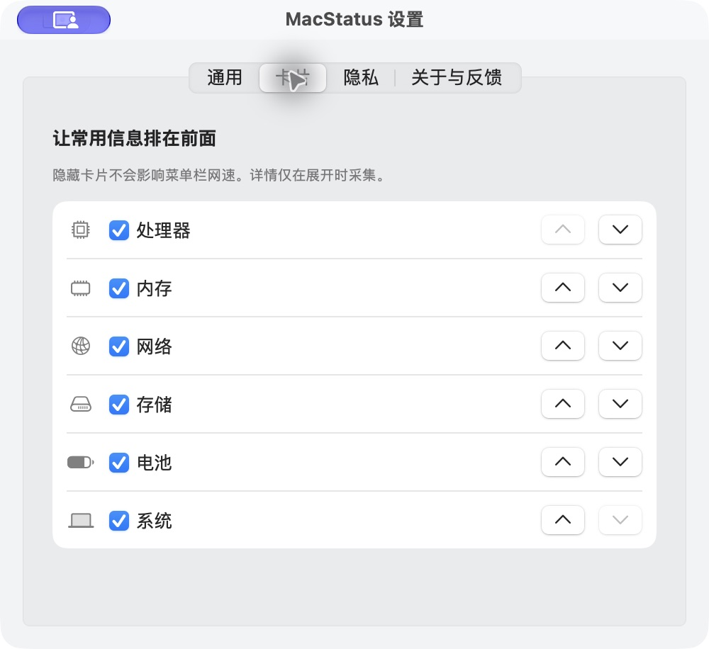

<p align="center">
  
</p>
<h1 align="center">MacStatus</h1>
<p align="center"><strong>Mac 的状态，一眼看见。</strong><br />一个原生、紧凑、按需采样的 macOS 菜单栏监控工具。</p>
<p align="center">
  <a href="README.en.md">English</a> ·
  <a href="#快速开始">快速开始</a> ·
  <a href="ROADMAP.md">路线图</a> ·
  <a href="https://github.com/zouxianggggg/MacStatus/issues">反馈与建议</a>
</p>
<p align="center">
  <a href="https://github.com/zouxianggggg/MacStatus/actions/workflows/ci.yml"></a>
  <a href="LICENSE"></a>
  
  
</p>

<p align="center"></p>

## 一个图标，六项状态

看一眼上传下载，展开看看哪个进程忙，或确认这次网络请求从哪里出去。MacStatus 把常用状态收进顶部菜单栏，点击后按需展开。

- **紧凑卡片**：默认概览约 352 × 378 点，六项信息各占一行。卡片可排序、隐藏，点击原位展开详情。
- **稳定的菜单栏网速**：下载、上传、双向速度自由选择。固定宽度、等宽数字，速度变化时图标保持稳定。
- **看清网络出口**：公网 IPv4 / IPv6、国旗、国别、ISP 和 AS，以及本地地址、DNS 和 Wi-Fi 链路信息。IP 与 DNS 一键复制。
- **详情按需读取**：CPU / 内存进程排行、各核心使用率、磁盘读写、电池与系统信息，进入对应卡片再采集。
- **原生 macOS 体验**：Swift + AppKit + SwiftUI，系统材质、深浅色外观、独立设置窗口、首次引导与系统登录项开关。
- **低资源占用优先**：一个采样定时器，后台降频，网速与完整指标分开采样。图表没有逐帧动画，趋势只保留在内存。

> **当前版本：0.5.0 开源预览版。** 欢迎从源码构建、体验和贡献。当前没有经过 Developer ID 签名及 Apple 公证的正式安装包；长期驻留、多机兼容和真实登录启动仍在验收中。

## 你能看到什么

| 模块 | 主要内容 |
| --- | --- |
| 处理器 | 总使用率、用户 / 系统使用率、各核心、平均负载、进程占用前五与趋势 |
| 内存 | 已用 / 总量、内存压力、压缩、缓存、交换空间、页读写与进程 RSS 排行 |
| 网络 | 上下行速度、累计流量、出口 IP 与国旗、网卡 / MTU、网关 / DNS / 代理、Wi-Fi 信号与协商速率 |
| 存储 | 容量与可用空间、文件系统、访问状态、块存储驱动合计读写速率与累计量 |
| 电池 | 电量、充电状态、循环次数、原始容量比、电压 / 电流、电池端功率、适配器额定功率 |
| 系统 | 机型、芯片、逻辑 / 物理 / 性能 / 能效核心、系统与内核版本、开机时长、系统热状态 |

传感器没有提供的数据会如实显示不可用。GPU、具体温度、风扇控制和整机功耗尚未实现；完整指标定义见 [技术说明](docs/TECHNICAL_NOTES.md)。

## 快速开始

需要一台 Mac 和提供 Swift 5.9+、macOS SDK 的 Xcode 或相应开发工具。当前没有第三方 Swift 包依赖。

```sh
git clone https://github.com/zouxianggggg/MacStatus.git
cd MacStatus
./scripts/build.sh
open dist/MacStatus.app
```

构建脚本生成本机架构的应用，并在本机进行临时签名。也可以在 Xcode 中打开 `Package.swift` 查看和运行项目。

1. 点击顶部菜单栏的仪表图标，展开监控面板。
2. 点击任意卡片查看详情，再次点击收起；点击外部关闭面板。
3. 右上角进入设置，选择网速显示、采样策略、卡片顺序与隐私偏好。
4. `⌘ ,` 打开设置，`⌘ W` 关闭设置窗口；右键菜单栏图标可退出。

**兼容范围**：源码部署目标为 macOS 13+；手动界面验证设备为 Apple M1 / 16 GB / macOS 27.2。Intel、其他系统及多显示器的实机体验仍待验证。构建和测试结果见本仓库 Actions，不能代替完整机型兼容性验收。

<details>
<summary><strong>看看卡片设置</strong></summary>
<br />


截图来自实际运行的 0.5.0 应用，界面语言目前为简体中文。
</details>

## 轻量，落实到采样方式

| 场景 | 标准模式 | 节能模式 |
| --- | --- | --- |
| 面板可见 | 每 2 秒更新 | 每 5 秒更新 |
| 面板关闭，完整指标 | 约每 10 秒 | 约每 30 秒 |
| 启用菜单栏网速 | 网络计数单独每 2 秒 | 网络计数单独每 5 秒 |
| 进程 / 核心 / 磁盘活动 / Wi-Fi 详情 | 对应卡片展开时读取 | 对应卡片展开时读取 |

历史记录最多 15 分钟、450 个点；图表显示最近两分钟，冷启动从右侧积累真实样本。休眠停止采样，唤醒重建差分基线。设置和引导窗口按需创建，关闭后释放引用。

一次 Apple M1 / macOS 27.2 的 **30 秒后台短测**中，开启双向网速时，0.5.0 平均 CPU 约为单核的 **0.9%**，物理内存冷启动约 **14 MB**；使用并关闭设置后约 **39 MB**。这些是特定场景的观测值，不是所有设备的保证，也不代表长期耗电或无泄漏。方法与完整对照见 [性能记录](docs/PERFORMANCE.md)。

## 隐私与你的控制权

本机监控在本地完成，项目没有账号、遥测或自动上传问题报告。

公网查询是唯一用于监控详情的在线服务：展开网络详情时，应用通过 [ipify](https://www.ipify.org/) 获取请求出口 IP，再将这个公网 IP 交给 [ipwho.is](https://ipwhois.io/documentation) 查询归属地。服务自然会看到请求的出口地址；应用不附带本机指标、局域网地址或设备标识。

结果只在内存缓存 5 分钟。你可以在「设置 → 隐私」关闭查询，取消请求并清除结果；本地网速继续工作。国旗表示 IP 数据库归属地，HTTPS 请求出口可能受系统代理、VPN 和分流影响。

反馈前请检查你补充的截图和文字。应用内复制的问题报告默认不附带 IP、DNS、进程列表、用户名、序列号或文件路径。更多说明见 [隐私说明](docs/PRIVACY.md)。

## 一起把它打磨好

欢迎提交 [Bug 与使用反馈](https://github.com/zouxianggggg/MacStatus/issues/new/choose)、补充不同机型 / 系统的兼容性记录，或贡献原生界面、指标准确性和资源优化方面的改进。

近期重点是 **网络诊断、克制的异常提醒和有容量上限的历史记录**；正式签名、公证与更新分发列在后续阶段。完整范围见 [路线图](ROADMAP.md)。

如果这个工具对你有帮助，欢迎 Star、分享给同样喜欢原生 Mac 小工具的朋友。想提交代码，请先读 [贡献指南](CONTRIBUTING.md)。

## 开发与许可

```sh
swift test --cache-path "$PWD/.build/cache" --scratch-path "$PWD/.build"
./scripts/build.sh
```

项目目前有 28 项单元检查，覆盖计数回绕、网络重连、曲线初始行为、偏好迁移、采样调度和菜单栏固定几何。开发预览与手动验证步骤见 [开发说明](docs/DEVELOPMENT.md)。

以 [MIT License](LICENSE) 开源。
